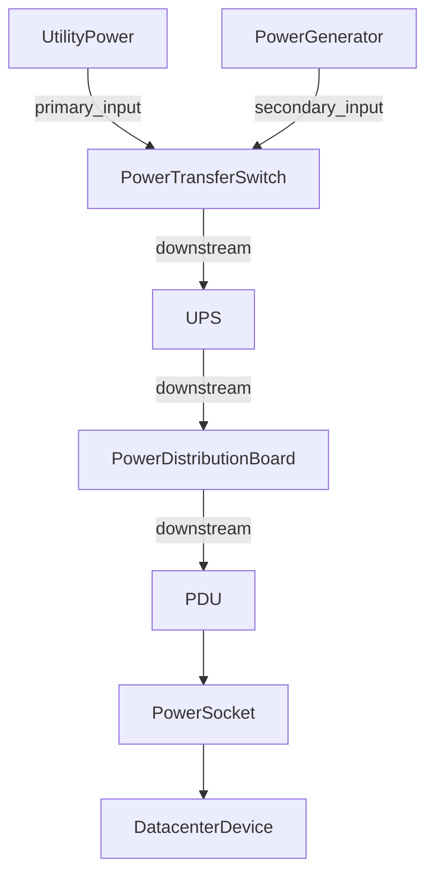
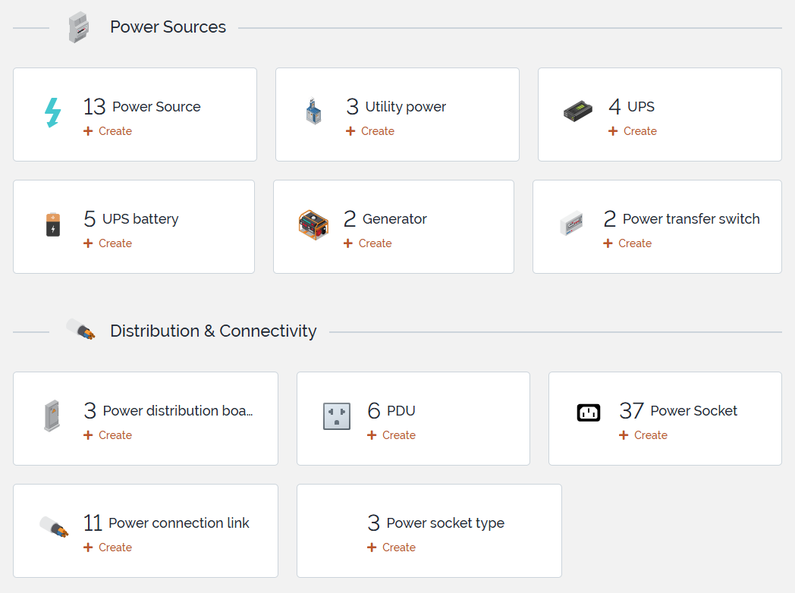
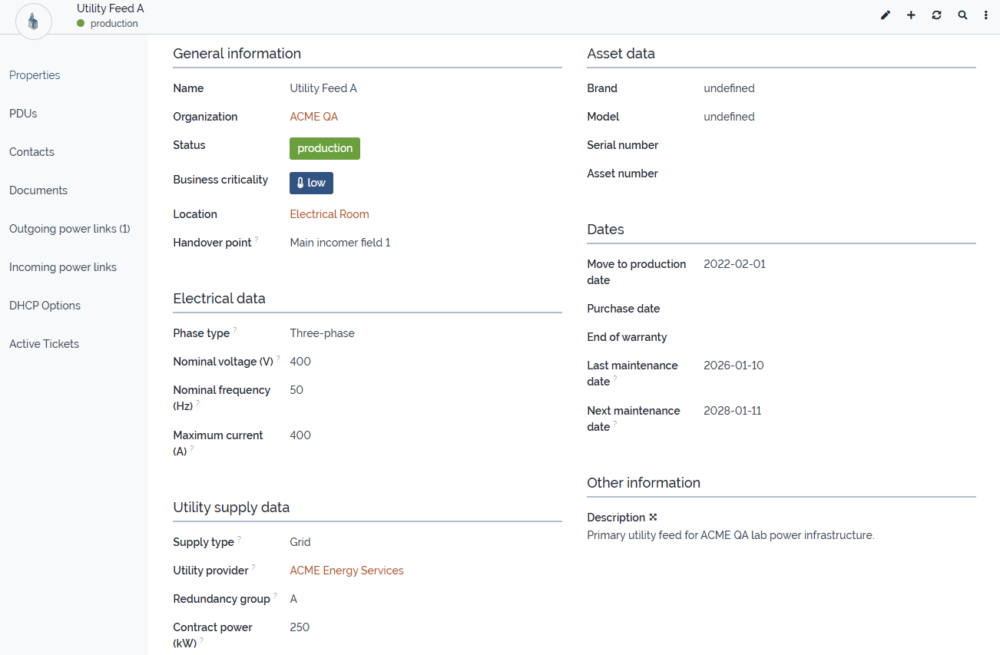
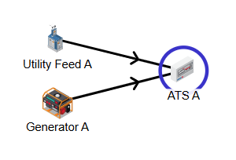
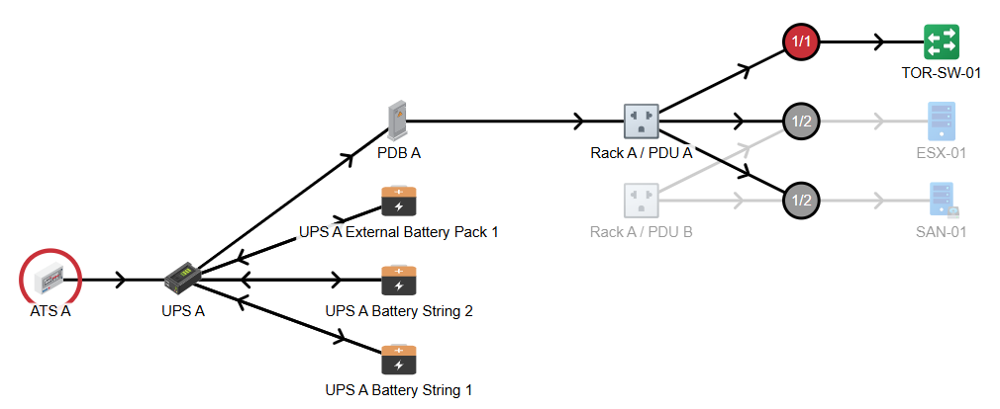
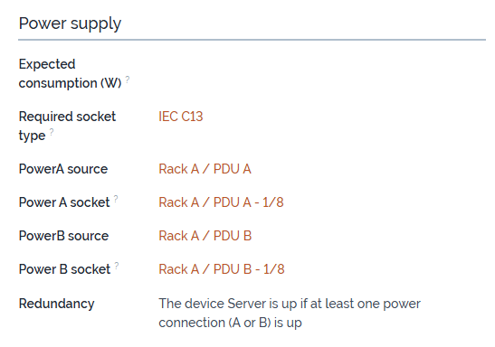
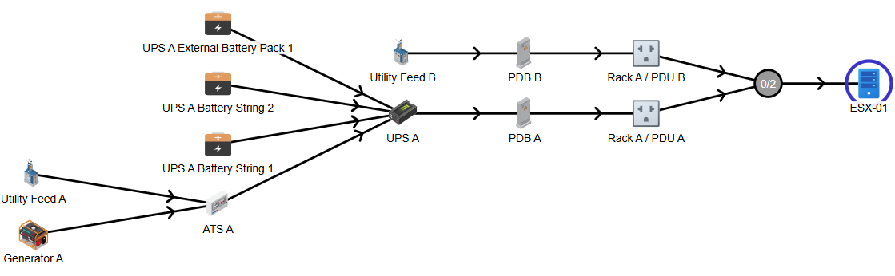

# iTop-br-power-infrastructure

Copyright (c) 2026 Björn Rudner

## What?

`iTop-br-power-infrastructure` is an extension for iTop that enhances the native CMDB data model for documenting and managing electrical power infrastructure components.

It extends the native iTop power model and introduces additional classes, attributes, synchronization logic, and generic topology links for documenting power supply paths in environments such as data centers, server rooms, technical facilities, and related infrastructure areas.

## Features

* Extends the native iTop power infrastructure model
* Adds generic electrical and maintenance-related attributes to existing power classes
* Introduces dedicated classes for:

  * `UtilityPower`
  * `UPS`
  * `UPSBattery`
  * `PowerGenerator`
  * `PowerTransferSwitch`
  * `PowerDistributionBoard`
  * `PowerSocketType`
  * `PowerSocket`
* Introduces `lnkPowerConnectionToPowerConnection` for generic directional topology modeling between `PowerConnection` objects
* Extends `PDU` with dedicated power socket handling
* Supports Power A / Power B assignment for `DatacenterDevice` objects
* Includes synchronization logic between `PowerSocket`, `PDU`, and `DatacenterDevice`
* Supports both legacy native power relations and the preferred generic topology model

## Main Classes

The extension builds on the following native iTop classes:

* `PowerConnection`
* `PowerSource`
* `PDU`
* `DatacenterDevice`

The extension introduces the following additional classes:

* `UtilityPower`
* `UPS`
* `UPSBattery`
* `PowerGenerator`
* `PowerTransferSwitch`
* `PowerDistributionBoard`
* `PowerSocketType`
* `PowerSocket`
* `lnkPowerConnectionToPowerConnection`

## Preferred Topology Model

The preferred way to model power flow in this extension is the generic link model:

* `lnkPowerConnectionToPowerConnection`

This allows directional relationships between `PowerConnection` objects, for example:

* utility feed → transfer switch
* generator → transfer switch
* transfer switch → UPS
* UPS → distribution board
* distribution board → PDU

Recommended role usage:

* use `downstream` as the standard generic source-to-target role
* use `primary_input` and `secondary_input` for transfer switch input modeling

The native iTop `PowerSource` → `PDU` relation remains supported for compatibility.

## Example Topology

## Compatibility

Power Infrastructure 3.3.x requires iTop 3.3.0 or later.
Earlier installations are maintained on the [itop/3.2 branch](https://github.com/rudnerbjoern/iTop-br-power-infrastructure/tree/itop/3.2).

iTop Setup requires Configuration Management, Datacenter Management,
Virtualization Management, and Storage Management at version 3.3.0 or later.

## Installation

1. Extract the release ZIP into the iTop extensions directory. The descriptor
   is at `extensions/br-power-infrastructure/extension.xml`.
2. Run iTop Setup and select **Datamodel: Power Infrastructure**.
3. Complete the model update and check the device and PDU detail views.

### Optional TeemIP bridge

For PDU MAC and IP address integration, install TeemIP Core 3.3.1 or later.
iTop automatically selects the bridge when Power Infrastructure and the
TeemIP IP Management, Configuration Management, and Datacenter Management
adapters are selected. The TeemIP Configuration Management adapter requires
module version 3.3.0 or later, and the Datacenter Management adapter requires
3.2.3 or later. TeemIP Core 3.3.1 includes both versions.

### Optional Datacenter View bridge

With Molkobain Datacenter View 1.15.0 or later selected, iTop Setup selects the
standard bridge automatically. The PDU details show enclosure, vertical position,
and rack-unit height alongside the rack in the General Information fieldset.

The Datacenter View Extended bridge for iTop 3.2 is available on the maintenance branch.

## Upgrade Notes for Version 2.0.0

Version `2.0.0` further establishes the generic link model `lnkPowerConnectionToPowerConnection` as the preferred way to document directional relationships between `PowerConnection` objects.

When upgrading across version 2.0.0:

* existing legacy `PDU.powerstart_id` relations are imported into the generic link model with role `downstream`
* existing generic links using the role `output` are migrated to `downstream`
* duplicate `downstream` links are not created

The legacy `powerstart_id` field is not removed during upgrade.

## Documentation

A more detailed guide covering modeling principles, class usage, topology design, screenshots, demo data, and migration behavior is available here:

* [User Guide](doc/User-Guide.md)

## Screenshots

### Power Infrastructure Overview

### Utility Power

### Transfer Switch Relations

### Redundant Device Power Assignment

## Attribution

This extension uses icons from:

 by Arthur Shlain from [https://thenounproject.com/browse/icons/term/power-connector/](https://thenounproject.com/browse/icons/term/power-connector/)
